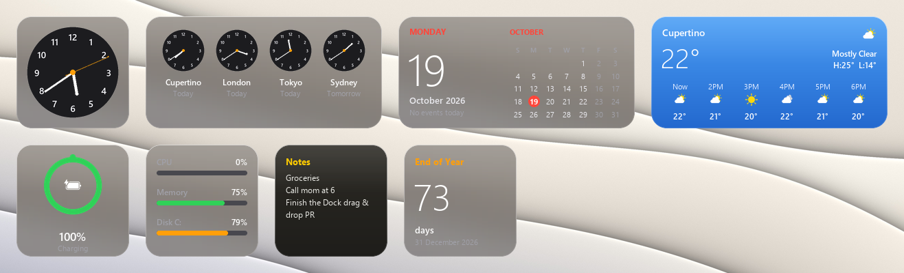
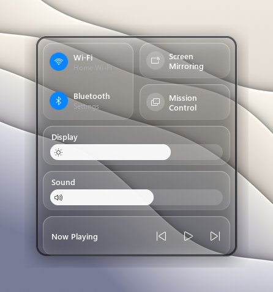
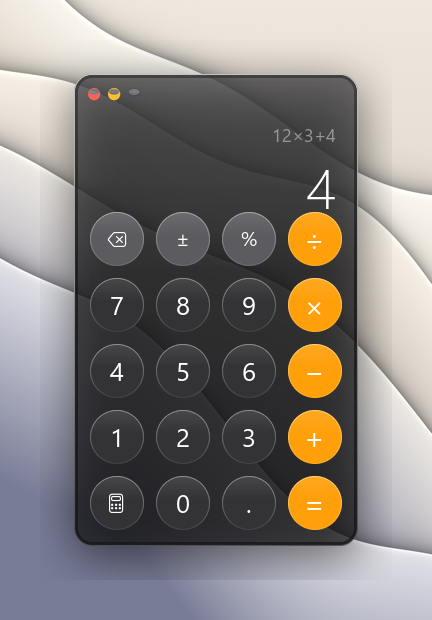
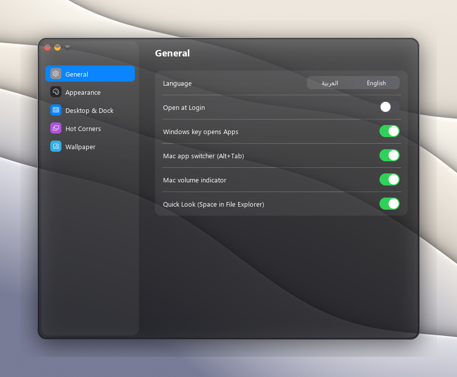
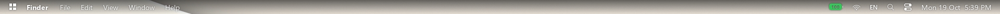
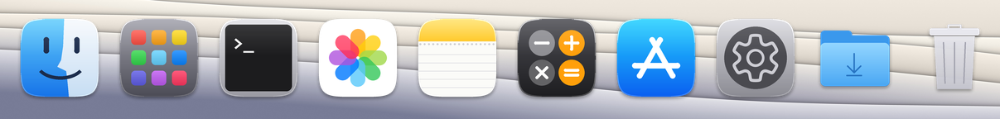
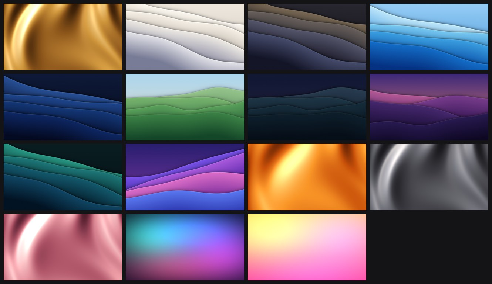

# Mac Interface for Windows

**A macOS-style desktop for Windows 11 — menu bar, Dock, Liquid Glass, widgets, Spotlight and more — without touching a single Windows system file.**



Mac Interface is a lightweight Python app that replaces the parts of Windows you look at every day with Mac-style versions: a translucent menu bar, a magnifying Dock, desktop widgets, Control Center, Spotlight, Quick Look, an app switcher and more. Everything is drawn from scratch, everything is reversible, and it idles at about **0.2% CPU and ~80 MB RAM**.

> Not affiliated with or endorsed by Apple Inc. "Mac", "macOS" and "Liquid Glass" are trademarks of Apple Inc. No Apple artwork, icons, wallpapers or sounds are included — every visual and sound here is original.

---

## Highlights

| | |
|---|---|
| **Menu bar** | Transparent like macOS 27, with the logo menu, the app's name and its *real* menus (for classic Windows apps), battery, Wi‑Fi, input language, Spotlight, Control Center and the clock. One per monitor. |
| **Dock** | Magnification, bounce on launch, running-app dots, drag apps/files/folders onto it, drag to reorder, drag out to remove, right-click menus, a Trash that fills up and can be emptied. |
| **Real Liquid Glass** | Live blur of whatever is behind (even other apps) using Windows' own GPU compositor, plus specular rim highlights. A slider goes from clear to tinted. |
| **Control Center** | Wi‑Fi, Bluetooth, screen mirroring, Mission Control, a working brightness slider, a working volume slider and media controls. |
| **Spotlight** | `Alt+Space`. Finds apps, does math (`12*3+4` → `40`), searches the web. |
| **Apps** | Full-screen app launcher with search (replaces Launchpad). The **Windows key** opens it instead of Start. |
| **App switcher** | `Alt+Tab` shows a Mac-style switcher instead of the Windows one. |
| **Quick Look** | Select a file in File Explorer and press **Space** to preview images, text and code. |
| **Widgets** | Clock, World Clock, Calendar, Weather (hourly + 5-day), Battery, System, Notes, Photos, Countdown, App Shortcuts — in small/medium/large — plus your own widgets from a tiny JSON file. |
| **Mac apps** | Calculator, About This Mac, Force Quit (`Ctrl+Alt+Esc`) and a System-Settings-style preferences window. |
| **Hot corners** | Mission Control, Desktop, Spotlight, Apps or Lock Screen from any screen corner. |
| **Volume HUD** | Volume keys show a Mac-style indicator instead of the Windows one. |
| **Windows theme** | Mac-style mouse pointers (including the spinning beach ball), soft system sounds, document icons per file type, blue folders, Mac blue accent color. |
| **Wallpapers** | 15 original 4K wallpapers in the spirit of macOS (Golden Gate, Tahoe, Sonoma, Big Sur, Sequoia…), with automatic day/night switching. |
| **Languages** | English by default, full Arabic support with right-to-left layout (Settings → General → Language). |

<p>



</p>





---

## Requirements

- Windows 11 (Windows 10 mostly works, without rounded glass corners)
- Python 3.10 or newer — get it from [python.org](https://www.python.org/downloads/) (tick *Add Python to PATH*)

## Install & run

```powershell
git clone https://github.com/ZEED-12/mac-interface-windows.git
cd mac-interface-windows
pip install -r requirements.txt
python mac.py
```

Then choose:

1. **Apply the Mac look to Windows** — wallpaper, pointers, sounds, icons, accent color (takes about a minute the first time while it renders the 4K wallpapers).
2. **Start Mac Interface** — the menu bar, Dock and widgets appear.

To start it automatically with Windows: *Mac Interface Settings → General → Open at Login*.

## Keyboard shortcuts

| Keys | Action |
|---|---|
| `Windows` | Apps (instead of Start) |
| `Alt+Space` | Spotlight |
| `Alt+Tab` | Mac app switcher |
| `Ctrl+Alt+Esc` | Force Quit Applications |
| `Space` in File Explorer | Quick Look |
| Volume keys | Mac volume HUD |

Each of these can be switched off in *Settings → General*.

## Safe by design

- **No Windows system files are modified.** Only per-user settings are changed, and every original value is saved to `mac_backup.json` *before* it is changed.
- **Fully reversible:** `python mac.py` → **Restore everything** or **Uninstall Mac Interface completely**. Restore was tested end to end: the taskbar, wallpaper, pointers, sounds, colors, icons and menus all come back.
- The only optional admin step (Mac folder icons in every File Explorer window) asks first and is also restored.
- If something ever goes wrong, option **7** brings the Windows taskbar back immediately.

## What it can't change (yet)

Being honest about the limits: the inside of other apps' windows (title bars, File Explorer, Windows Settings), Windows notifications, the lock screen and UAC prompts are drawn by Windows itself and can't be restyled without patching system files — which this project will never do. Ideas that stay within that rule are very welcome.

## Make your own widget

Drop a JSON file into `widgets_custom/`:

```json
{ "title": "Reminder", "type": "text", "text": "Drink some water", "size": "small", "color": "#0a84ff" }
```

`"type": "command"` runs a command and shows its output. See `widgets_custom/README.md` (created on first run) for all options and the Python plugin API.

## Project layout

| File | What it does |
|---|---|
| `mac.py` | Entry point, interactive menu, applying/restoring Windows settings |
| `macui.py` | Drawing toolkit, layered windows, Liquid Glass, menu bar, Dock, popups |
| `macapps.py` | Calculator, About, Settings, Apps launcher, Force Quit |
| `controlcenter.py` | Control Center, Wi‑Fi/battery menus, Spotlight |
| `overlays.py` | App switcher, volume HUD, Quick Look |
| `widgets.py` | Desktop widgets, gallery, custom widgets |
| `keyboard_hook.py` | Windows key / Alt+Tab / volume keys / Space handling |
| `system_theme.py` | Generated pointers, sounds and file icons |
| `wallpapers.py` | Procedural 4K wallpapers |
| `settings.py` | Settings and English/Arabic strings |
| `arabic.py` | Arabic shaping and right-to-left ordering (no dependencies) |

## Contributing

Help is very welcome — design, code, testing, translations. Start with [CONTRIBUTING.md](CONTRIBUTING.md) and the issues labelled **good first issue**. Every pull request is checked by the tests in `tests/`.

## License

[MIT](LICENSE) © 2026 ZEED-12 and contributors.

---

## بالعربي

**واجهة ماك لويندوز**: شريط علوي و Dock وزجاج سائل حقيقي وأدوات و Spotlight و Quick Look ومبدّل تطبيقات، بدون ما يتعدل أي ملف من ملفات ويندوز، وكل شي يرجع مثل ما كان بضغطة.

- التشغيل: `pip install -r requirements.txt` ثم `python mac.py` واختر 1 ثم 2.
- اللغة الافتراضية إنجليزي، والعربي مدعوم بالكامل من اليمين لليسار: *الإعدادات ← عام ← اللغة*.
- تبي تساعد في التطوير؟ اقرأ [CONTRIBUTING.md](CONTRIBUTING.md) وشوف المهام المكتوب عليها **good first issue**.
